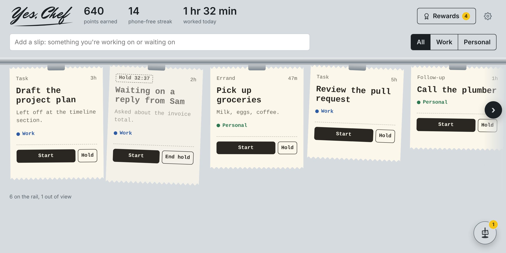

# Yes, Chef

A focus app built like a kitchen ticket rail. Everything you have in flight is a slip on the rail. Pull one and work it, put it on hold while you wait on someone, and spike it when it's done. Focused time earns points toward rewards you pick yourself.

**[Try it in your browser](https://kkubesh.github.io/yes-chef/)**. No account, no install, and nothing you type leaves your device.

## Why I made this

I've tried a lot of planning apps. The thing that's worked best for me is a plain paper checklist, because it's always sitting there in front of me. The trouble is a notebook gets left behind, and an app I can open anywhere is an app I tell myself I'll check later.

My days also don't look like a neat to-do list. I usually have two or three things running at once. Starting is hard, guessing how long things take is hard, and every time I switch I lose the thread. The times I've focused best were long single-project stretches. I loved Cal Newport's *Deep Work*, but I've always struggled to actually get into it day to day. This is my attempt to make getting there easier.

A kitchen ticket rail fixed that problem a long time ago. Every order is a slip you can see. You pull one, work it, and spike it when it's done. Anything you're waiting on gets held and comes back when it's ready. Nothing lives only in your head. Yes, Chef is that rail for my day: one slip at a time and a spike that shows what I actually finished.

It runs entirely on your own device. No account, no server, nothing sent anywhere. I built it for me, and I'm sharing it in case it helps you too.

Feedback is welcome. If you have an idea or hit a problem, open an issue on this repo.

## What it does

- **The rail:** every task is a slip you can see. Filter it to work or personal, and rename the slip types to fit how you work.
- **Focus sessions:** a timed burst (10 to 45 minutes, or your own length) or an open clock that counts up until you stop. Jot where you left off right on the slip.
- **Hold:** waiting on a reply? Put the slip on hold and it comes back to the front, with a chime, when the time is up.
- **A quick check:** after each session, one yes or no question about what you're keeping away from (your phone, by default). A No earns full points.
- **Points and rewards:** focused minutes earn points to spend in your own reward shop, like a break, a coffee run or dinner out.
- **The spike and shifts:** finished slips land on the spike. End a shift to get a receipt of what you worked on, kept under Past shifts.
- **Your data:** saved to a file you choose, or in the browser on a phone, with Export and Import for backups.

## Use it on a Chromebook

The easiest way is the [live site](https://kkubesh.github.io/yes-chef/) in Chrome. If you'd rather have it as a file that works with no internet at all:

1. Download `index.html` from this repo (open it, then use the download button), rename it `yes-chef.html` if you like, and put it in **My files**.
2. Double-click it in the **Files** app. It opens in a Chrome tab.
3. Choose where your tickets live:
   - **Create a new data file** to start fresh. Save `yes-chef-data.json` somewhere in My files.
   - **Open an existing file** to keep working from a data file you already have, including a copy of the Mac version's `data.json`.
   - **Just save in this browser** if the Chromebook won't allow files. It works, but clearing browsing data would erase it.
4. Pin the tab. From then on it saves to your file automatically as you work.

After Chrome restarts, you may see **Open yes-chef-data.json**. One click lets Chrome back into the file.

## Use it on more than one device

Yes, Chef doesn't sync on its own, because it never goes online. But you can keep its data file in Google Drive and let Drive carry it between devices. The same idea works with Dropbox, iCloud Drive or OneDrive.

### Set it up

1. **First device:** open `yes-chef.html` and choose **Create a new data file**, or **Use a different data file** in Settings if you already have data. In the save window, pick a folder in **Google Drive**:
   - **Chromebook:** Google Drive is already in the Files app, in the left sidebar.
   - **Mac or Windows:** install **Google Drive for desktop**. Your Drive then shows up as a folder (on a Mac, under Locations in the sidebar).
2. **Each other device:** get `yes-chef.html` onto it, open it, choose **Open an existing file**, and pick that same file in Google Drive.

That's it. Every device now reads and saves the same file.

### The one rule: one device at a time

Yes, Chef reads the file when the tab opens and saves the whole thing when anything changes. If two devices have it open, whichever saves last wins and the other device's changes are lost. Even an idle tab can save, for example when a hold runs out.

- **Leaving a device:** close the Yes, Chef tab. Give Drive a few seconds to finish syncing (on a Mac, the Drive icon in the menu bar stops spinning).
- **Sitting down at a device:** open, or reload, the Yes, Chef tab so it reads the latest file.
- **Chromebook offline?** Drive files there sync when you're back online. Before switching devices, make sure the Chromebook has been online long enough to upload its changes.

### If something goes wrong

- **A "yes-chef-data (1).json" shows up:** two devices saved at nearly the same time, and Drive kept both. Open each one (Settings → **Use a different data file**), keep the one with your latest work, and delete the other.
- **Lost changes:** Google Drive keeps earlier versions of the file for about 30 days. In Drive on the web, right-click the file and choose **File information → Manage versions** to download an older copy, then open it with **Open an existing file**.
- **Saving to Drive fails on a Chromebook:** some Chromebooks don't allow saving into Drive from a web page, and you'll see a yellow "Couldn't save" notice. Your work is still kept in the browser. Save the data file in **My files** instead, and copy it to Drive by hand when you switch devices.

### On a phone

Phones can't save to a file from a web page, so on a phone Yes, Chef saves inside the browser. That works, but the data lives only in that browser on that phone. Use **Settings → Export data** now and then to keep a backup file (save it to Files, iCloud or Drive). **Import data** loads a backup on a new phone, or brings in a board from a computer.

### Without Drive

You can always move your data by hand. Use **Settings → Export data** (or copy your data file), get it to the other device (USB stick, email to yourself, AirDrop), and use **Import data** or **Open an existing file** there. A copy of the Mac app's `data.json` works too.

## What this file does and doesn't do

Downloading a web page file from someone can reasonably make you pause, so here's exactly what this one does.

**It does:**
- Run entirely inside your Chrome tab. It's one self-contained file: the code, fonts and logo are all built in.
- Read and write **one** data file: the one you pick or create in Chrome's own file picker. It can't see anything else on your computer.
- Keep a backup copy of your data inside Chrome on this device, so a missing file doesn't lose your work.

**It doesn't:**
- Connect to the internet. There are no accounts, no analytics, no ads and no "phoning home." It works with Wi-Fi turned off.
  Chrome enforces this, not just the code: a line at the top of the file (a Content Security Policy) tells Chrome to refuse any connection the page tries to make. Anyone technical can check that one line instead of reading the whole file.
- Load anything from other websites.
- Send your tickets, notes or points anywhere. They stay on this device.
- Need you to install anything or grant any permission beyond picking a file.

**Worth knowing:**
- Your data file is plain text (JSON), not encrypted. Anyone who can use this computer or this Chrome profile can read it. Keep anything confidential out of ticket names and notes, especially on a shared or work-managed device.
- Your Chromebook and Mac keep separate data. Nothing syncs, because nothing leaves the device.

### Make sure you have the real file

Because this is a plain file, anyone could edit a copy and pass it along. Get it from this repo or the live site, not from a copy someone passed along. To double-check a copy, compare its fingerprint (SHA-256) with the one below. If they match, the file is exactly the one Erro released.

<!-- checksum:start -->
`fc2cf939230a2acdf58a502f6b96b87f8ffe990d770b912256e1908e1f1892d0`
<!-- checksum:end -->

- **Mac:** open Terminal, type `shasum -a 256 ` (with a space at the end), drag the file into the window, and press Return.
- **Windows:** in PowerShell, run `Get-FileHash index.html` (or whatever you named the file)
- **Chromebook:** there's no built-in tool for this, so check the copy on a Mac or PC before moving it over.

## The code

Everything is plain HTML, CSS and JavaScript, with no framework and no tracking.

- `public/index.html`: the whole app. Every change starts here.
- `server.js`: a tiny Node server (no dependencies) that runs the app on your own computer and saves to a `data.json` next to it. See [MAC-APP.md](MAC-APP.md) to run it.
- `index.html`: the browser version, the page GitHub Pages serves. It's generated from `public/index.html`, so don't edit it by hand.
- `browser-build/`: `build.py` turns `public/index.html` into the single browser file. It swaps the server storage for a file you pick, builds in the fonts and adds the security line. Run `npm install` there once (for the fonts), then `python3 build.py`, and copy the `yes-chef.html` it writes over `index.html`.
- `tests/`: sample data files from each version, and a check that they all still open (`node tests/check-data.js`, needs Playwright).
- `data.json`, `backups/` and `test-run/` hold your own data and are never committed (see `.gitignore`).

## Support

Yes, Chef is free. If it helps you focus, you can [buy me a coffee](https://buymeacoffee.com/kkubesh). The link at the bottom of Settings opens that page in a new tab; it's a plain link, so the app itself still never connects anywhere.

## Good to know

- Your data stays on the device, in the file you picked, plus a safety copy inside Chrome.
- Each device keeps its own data unless you set up a shared file. See **Use it on more than one device** above.
- To switch to a different data file later: **Settings → Use a different data file**.
- Fonts and the logo are built into the file, so it looks the same offline.
- On a school- or work-managed Chromebook, an admin can block opening local files or saving to them. If that happens, use **Just save in this browser**.
